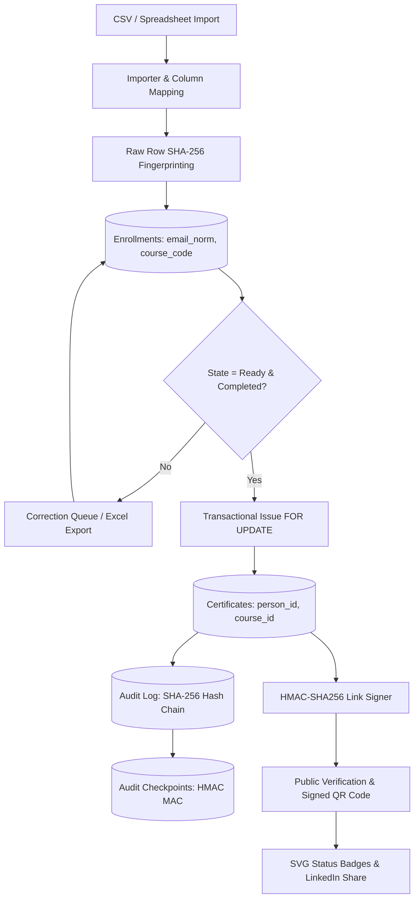

# Certificate Ledger (A-B-01)

A production-quality, tamper-evident certificate issuance & verification system designed to keep mathematically accurate records across the complete credential lifecycle:
**attendee import → correction → eligibility → issuance → batch printing → public verification → revocation**.

Deployable on **Supabase (Managed PostgreSQL) + Vercel** or self-hosted on Node.js/TypeScript.

---

## Architecture Diagram

---

## Key Stand-Out Capabilities

- **F1 Tamper-Evident Audit Hash Chain**: Every state mutation is cryptographically chained using SHA-256 canonical JSON representations (`[seq, at, action, entity, entity_id, detail, prev_hash]`) with HMAC checkpoints. The activity view features an interactive chain-walk verifier.
- **F2 Live Ledger Health Diagnostics**: 16 real-time invariant tests proving `eligible = pending + issued + revoked`, dual independent table recounts, referential integrity, and an active **"Try to Break It" Probe** that attempts a duplicate insert in a rolled-back transaction to prove PostgreSQL constraints hold.
- **F3 Signed QR Codes & Link Verification**: Every printed certificate embeds a QR code with an HMAC-SHA256 signature tag (`?s=...`). Altered or forged links trigger a red `LINK ALTERED` seal without leaking recipient existence.
- **F4 Rate-Limited Lookups & Cooldowns**: Brute-force protection on public lookups, notfound counters, and login attempts using HMAC-hashed IPs (no raw IPs stored).
- **F5 Fuzzy Duplicate Review Queue & Merge**: Damerau-Levenshtein distance, nickname dictionary (Jon/John), and email domain typo clustering (`gmial.com` → `gmail.com`). Side-by-side comparison with safe conflict resolution that blocks merging if both identities hold certificates.
- **F6 "Fix in Excel" Round Trip**: Exports needs-correction records as CSV with UTF-8 BOM, formula-injection guards (`'` prefix on `=, +, -, @`), and plain-language fix instructions.
- **F7 Column-Mapping Wizard**: 4-step wizard with header auto-detection, delimiter sniffing, and manual overrides.
- **F8 Safe Import Undo**: Reversible import with strict safety gates that block rollback if certificates have already been issued.
- **F9 & F10 LinkedIn Sharing & Social Badges**: One-click "Add to LinkedIn" credential builder, SVG vector status badges (`/api/verify/{id}/badge.svg`), and OpenGraph metadata.
- **F11 Public Revocations API & Developers Portal**: Documented REST API with interactive test console and zero-PII revocation feed.
- **F12 Batch Certificate Printing**: Landscape A4 print view with page breaks, Fraunces serif typography, gold/emerald seals, and print-specific CSS.
- **F13 Exact Funnel Visualization**: Monotonically non-increasing stage flow: *Unique Records → Ready → Eligible → Issued Ever → Valid* with exact drop-off accounting.
- **F14 9-Stage Guided Demo Walkthrough**: Interactive tour with auto-play and expected vs. actual verification ticks.
- **F15 Per-Course Aesthetic Themes**: Classic (ivory/gold), Modern (white/indigo), Midnight (navy/gold), Forest (cream/green), and Slate (charcoal).

---

## Environment Variables (`.env.example`)

| Variable | Description |
|---|---|
| `DATABASE_URL` | PostgreSQL connection string. **Activates durable persistence** when set (Supabase: transaction pooler on port 6543). Unset → memory-only mode |
| `DIRECT_URL` | Unused by the Node app (reserved for Python tooling); migrations are pasted into the Supabase SQL Editor |
| `ORGANIZER_PASSCODE` | Shared secret passcode to unlock the organizer dashboard (default: `demo2026`) |
| `SYSTEM_RESET_KEY` | Confirmation key for the dashboard factory-reset (default: `system_reset_csi_2026`) |
| `SESSION_SECRET` | Secret key (≥ 32 chars) used to sign session cookies (`openssl rand -hex 32`) |
| `LEDGER_SIGNING_KEY` | Secret key (≥ 32 chars) used for HMAC QR signatures and audit checkpoints |
| `LEDGER_SIGNING_KEY_PREVIOUS` | Optional previous key for seamless zero-downtime key rotation |
| `PUBLIC_BASE_URL` | Base URL of deployed application (used in QR codes) |
| `RATE_LIMIT_VERIFY_PER_MIN` | Allowed public verification requests per minute per IP (default: 30) |

---

## Deploy (Supabase + Vercel) — live database

The Node API persists its entire ledger as a single-row snapshot in Postgres
(`ledger_state`, guarded by an optimistic `version` column), so every Vercel
function instance boots from — and writes back to — one shared, durable state.
Certificates, imports, merges and the audit hash chain survive cold starts and
stay consistent across instances (conflicting concurrent writes get a 409 and
the client retries; every operation is idempotent).

1. Create a free project at [supabase.com](https://supabase.com).
2. In the SQL Editor run `supabase/schema.sql` once, then `supabase/persistence.sql`.
3. Project Settings → Database → Connection string → **Transaction pooler** (port `6543`).
   That URI is your `DATABASE_URL`. It authenticates with the database password —
   the app never needs Supabase anon/service-role keys.
4. On Vercel, import the repo and set env vars: `DATABASE_URL`, `SESSION_SECRET`,
   `LEDGER_SIGNING_KEY` (must differ), `ORGANIZER_PASSCODE`, `SYSTEM_RESET_KEY`.
   Leave `PUBLIC_BASE_URL` unset to auto-use `https://$VERCEL_URL`, or set your
   production domain.
5. Deploy. The first boot writes snapshot v1 (default courses + sample seed);
   the dashboard and public verification are live against the database.

Local development: `docker compose -f docker-compose.dev.yml up -d`, apply both
SQL files (`Get-Content supabase/schema.sql | docker exec -i cl-pg psql -U postgres -d postgres`,
same for `persistence.sql`), then `npm run dev` — the exact same code path as
production. Without `DATABASE_URL` the ledger runs memory-only (state resets on
restart).

Fail-closed by design: if the database is unreachable, the API answers 503
(`LEDGER_STATE_UNAVAILABLE`) instead of silently serving an empty ledger — a
verification endpoint must never return a false "not found".

---

## Cryptographic Integrity & Threat Model

### What the System Protects Against
1. **Silent Row Tampering or Deletions**: Any modification or deletion of an audit record breaks the parent hash chain and is immediately caught by `verifyAuditChain()`.
2. **Whole-Chain History Rewriting**: Even if an attacker re-computes every SHA-256 hash in SQL, they cannot generate valid HMAC checkpoint MACs without `LEDGER_SIGNING_KEY`.
3. **Forged or Altered QR Codes**: Changing any character in the URL or certificate ID invalidates the 16-character HMAC tag, displaying `LINK ALTERED` without leaking recipient existence.
4. **Race-Condition Duplicates**: PostgreSQL `UNIQUE (person_id, course_id)` and row-level locks (`SELECT ... FOR UPDATE`) physically prevent double issuance.

### What the System Does Not Protect Against
- An attacker with full database superuser privileges **and** the application server's `LEDGER_SIGNING_KEY`.
- Truncation of events occurring strictly after the latest signed checkpoint. External anchoring of the latest head hash (e.g. into an immutable external log) mitigates this.

---

## Reviewer's 2-Minute Verification Path

1. Log in with the default passcode: **`demo2026`**.
2. Click **"★ Launch Guided Demo Tour"** on the Dashboard and press **"Auto-Play All Steps"**. Watch all 9 stages complete with green checkmarks.
3. Open **Ledger Health**: inspect the live equation with real numbers (`11 eligible = 0 pending + 10 issued + 1 revoked ✓`) and click **"Execute Probe (Try to Break It)"** to see the PostgreSQL constraint halt duplicates.
4. Open **Activity Log** and click **"Shield Verify Ledger Integrity"**: watch the chain walk light up green with the verified head hash.
5. Open **Public Verify**, enter an issued ID, and verify the authentic signature indicator. Alter one letter of `?s=` to observe the instant `LINK ALTERED` security warning.
